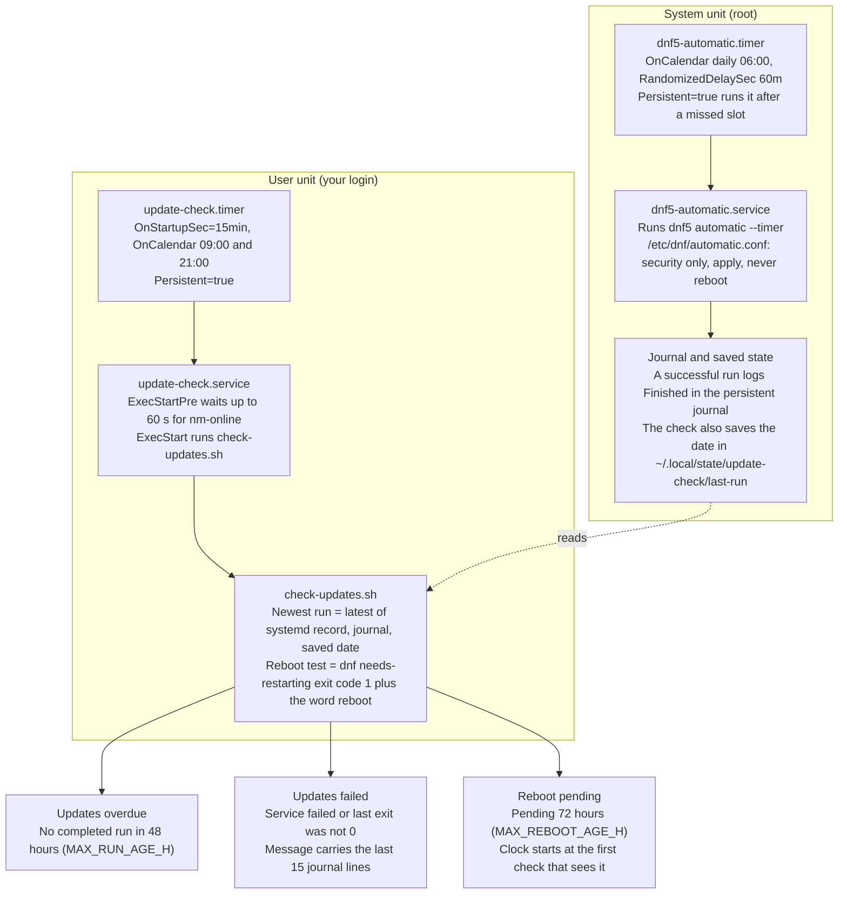
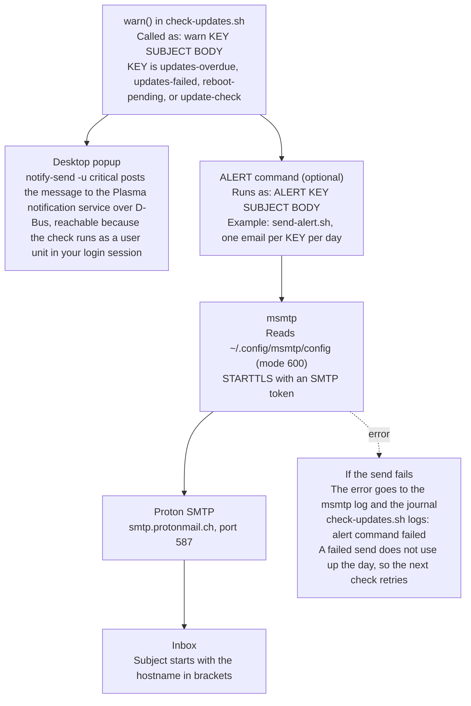

# Update workflow on Fedora

How the update timers, the check script, and the alerts connect. The diagrams match the files in `scripts/` and the settings in the [Fedora guide](fedora.md).

## From timers to warnings

Dashed arrow: the check reads what `dnf5-automatic` left behind.

- The two timers run independently. Neither starts the other.
- The check takes the newest completed run from three sources: systemd's record of the service, the journal, and the saved date. A check that starts in the same second as a run, which happens when both timers catch up after a suspend, can miss systemd's record. The journal covers that case.

## From a warning to the inbox

This is an example delivery path. `send-alert.sh` and the `msmtp` configuration are not part of this repository. Any command that accepts `KEY SUBJECT BODY` can serve as `ALERT`.

- Without `ALERT`, the desktop popup is the only output.
- The `nm-online` wait covers the network connection and not name resolution. A send can still fail just after a wake, and the failure path above handles that case.
